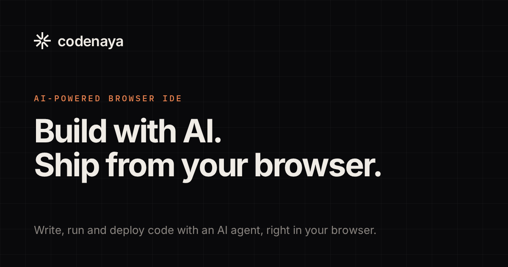
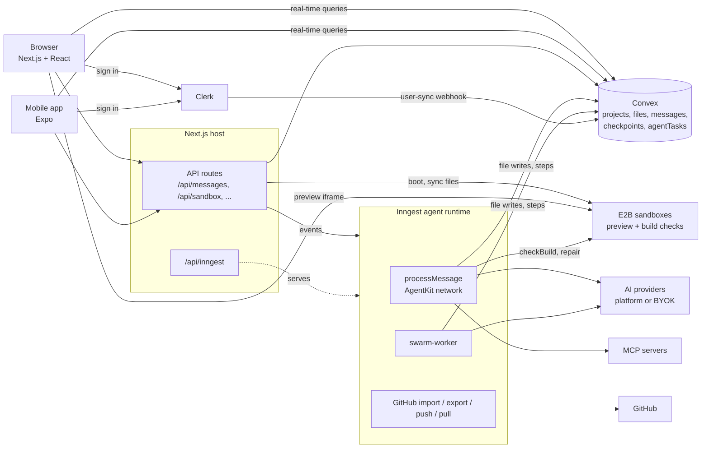
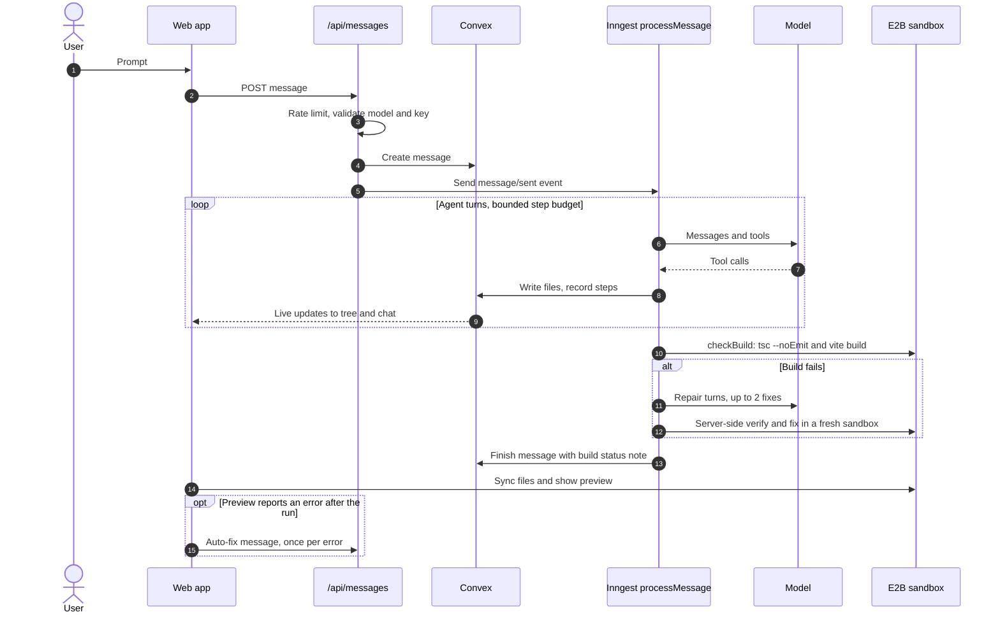
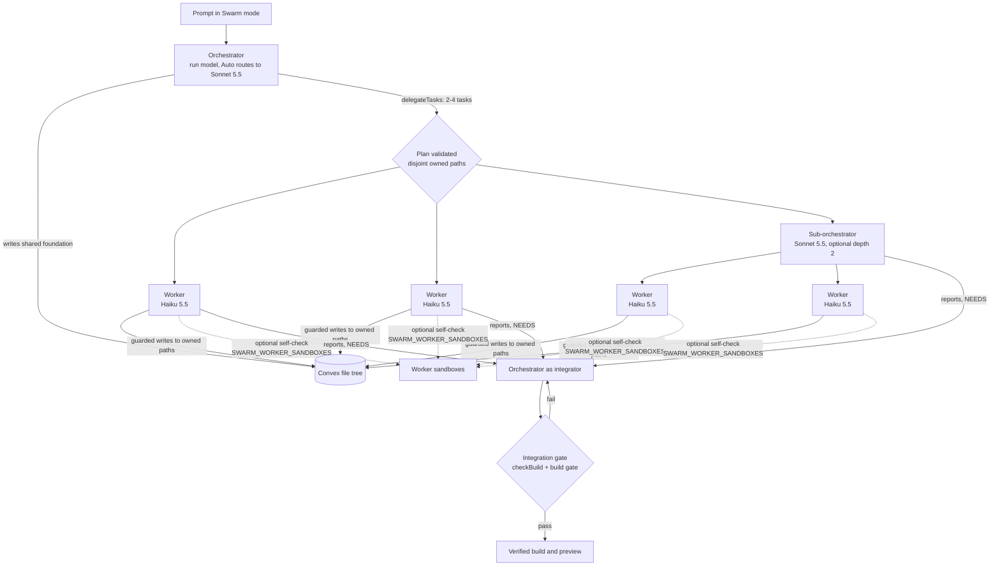
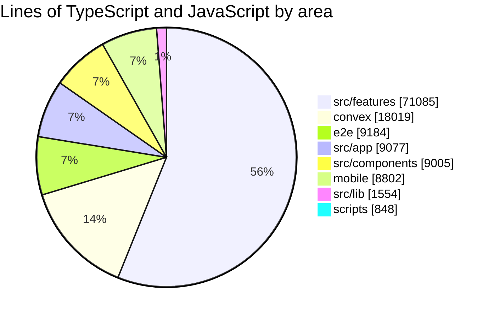

<p align="center">
  <a href="https://github.com/itsmrad/codenaya">
    <picture>
      <source media="(prefers-color-scheme: dark)" srcset="docs/assets/codenaya-banner-dark.svg">
      <source media="(prefers-color-scheme: light)" srcset="docs/assets/codenaya-banner.svg">
      
    </picture>
  </a>
</p>

<p align="center">
  <strong>The open-source AI app builder.</strong> Describe an app, watch agents build it in a cloud sandbox, and ship it from your browser.
  <br />
  <br />
  <a href="https://codenaya.tech"><strong>Website</strong></a>
  &middot;
  <a href="https://www.codenaya.tech/docs">Docs</a>
  &middot;
  <a href="https://github.com/itsmrad/codenaya/issues">Issues</a>
  &middot;
  <a href="#roadmap">Roadmap</a>
</p>

<p align="center">
  <a href="https://github.com/itsmrad/codenaya/actions/workflows/ci.yml"></a>
  <a href="LICENSE"></a>
  
  <a href="https://github.com/itsmrad/codenaya/pulse"></a>
  <a href="CONTRIBUTING.md"></a>
</p>

## Table of contents

- [About the project](#about-the-project)
- [Screenshots](#screenshots)
- [Built with](#built-with)
- [Architecture](#architecture)
- [Engineering facts](#engineering-facts)
- [Getting started](#getting-started)
- [Testing](#testing)
- [Deployment](#deployment)
- [Repository structure](#repository-structure)
- [Roadmap](#roadmap)
- [Contributing](#contributing)
- [Security](#security)
- [License](#license)

## About the project

<p align="center">
  
</p>

Codenaya is an AI website builder and agentic cloud IDE. You type a prompt; a coding agent plans the app, writes the files, runs a type check and a production build in an [E2B](https://e2b.dev) sandbox, fixes what fails, and opens a live preview. The editor, file tree, terminal and chat stay in the browser, so you can keep editing by hand or by asking.

What it does today (each item maps to code in [`src/features`](src/features) and [`convex/`](convex), and to a flow in [FEATURES.md](FEATURES.md)):

- **Prompt to working app.** The agent works through 17 file, build, scrape, env and skill tools, and must pass `checkBuild` (`tsc --noEmit` plus `vite build` in E2B) after its last write before a run can finish. A failed build gets bounded repair turns, then a server-side repair in a fresh sandbox. Errors the preview shows after a run are sent back to the agent once, automatically.
- **Agent Swarm.** For large builds, an orchestrator writes the shared foundation and delegates 2–4 tasks to parallel worker agents (Haiku 5.5 by default), with optional Sonnet 5.5 sub-orchestrators. Each worker owns disjoint paths, and everything ends in one integration build gate. See [ADR 0013](docs/adr/0013-agent-swarm.md).
- **Build, Ask/Plan and Swarm modes** in the chat composer, plus image input, prompt enhancement, past conversations, cancel and retry.
- **Cloud preview.** E2B sandboxes with a terminal, device sizes (desktop, tablet, mobile), project environment variables (secrets are sealed and never sent to the browser) and an in-browser engine option.
- **Source control.** Every build run snapshots the project first (the last 20 checkpoints are kept). The Source Control pane shows history, per-run and per-file diffs, and restore, and GitHub sync pushes runs as commits to a `codenaya-sync` branch and pulls changes back.
- **GitHub import and export.** Import public repos (private ones with a linked GitHub account), or export a project to a new repository.
- **Bring your own key (BYOK).** Use your own OpenRouter, OpenAI, Anthropic, Groq or custom OpenAI-compatible endpoint. Platform models are chosen per environment ([ADR 0005](docs/adr/0005-platform-ai-provider-by-env.md)) and per admin selection ([ADR 0006](docs/adr/0006-platform-provider-and-models-in-admin.md)).
- **MCP integrations catalog.** 18 providers (databases, payments, auth, monitoring, docs and more) plus any custom MCP server. Credentials use envelope encryption, connections are read-only by default, and destructive tools pause for approval. See [docs/INTEGRATIONS.md](docs/INTEGRATIONS.md).
- **Editor AI.** CodeMirror 6 with inline ghost-text suggestions and Cmd+K quick edit.
- **Skills, starter templates and a community showcase** for publishing, voting on and remixing projects.
- **Mobile app.** An Expo app in [`mobile/`](mobile) that uses the same Convex deployment, Clerk instance and API.

## Screenshots

<!--
  TODO(owner): add real product screenshots. Suggested set, saved under docs/assets/:
    docs/assets/ide.png       IDE with chat, editor and live preview
    docs/assets/swarm.png     Agent Swarm board during a build
    docs/assets/source-control.png  Source Control pane with a diff
  Then replace this comment with  tags. No screenshots exist in the repo yet,
  so none are shown here.
-->

> **TODO:** no product screenshots are in the repository yet. Maintainers: see the comment in this section of `README.md` for the suggested set.

## Built with

| Area | Technology |
| --- | --- |
| Web app | [Next.js 16](https://nextjs.org) (App Router), [React 19](https://react.dev), [TypeScript 5](https://www.typescriptlang.org), [Tailwind CSS 4](https://tailwindcss.com), [shadcn/ui](https://ui.shadcn.com) on Radix UI |
| Editor and terminal | [CodeMirror 6](https://codemirror.net), [xterm.js](https://xtermjs.org) |
| Backend and data | [Convex](https://convex.dev) (database, real-time queries, file storage, crons) |
| Agent runtime | [Inngest](https://www.inngest.com) with [AgentKit](https://agentkit.inngest.com), [Vercel AI SDK](https://ai-sdk.dev) for editor AI |
| Sandboxes | [E2B](https://e2b.dev) cloud sandboxes (custom Node 22 template), [WebContainer](https://webcontainers.io) as the in-browser option |
| Models | OpenRouter, OpenAI, Anthropic or Groq for the platform; any of them, or a custom endpoint, through BYOK |
| Auth | [Clerk](https://clerk.com) (including GitHub OAuth for import and sync) |
| Integrations | [Model Context Protocol](https://modelcontextprotocol.io) SDK, OAuth PKCE, AES-256-GCM envelope encryption |
| Observability | [Sentry](https://sentry.io) |
| Mobile | [Expo](https://expo.dev) and React Native |
| Testing | [Vitest](https://vitest.dev), [convex-test](https://www.npmjs.com/package/convex-test), [Playwright](https://playwright.dev) with axe-core |

## Architecture

### System overview



The Convex file tree is the source of truth. Agents write files to Convex; the open preview syncs that tree into its E2B sandbox. Inngest makes runs durable, cancellable and replay-safe, and keys are resolved outside Inngest steps so no secret lands in run history ([ADR 0002](docs/adr/0002-agent-runtime-inngest-agentkit-openrouter.md)).

### Request lifecycle: prompt to preview



The build gate lives in [`build-check-gate.ts`](src/features/conversations/inngest/build-check-gate.ts) and the server-side repair in [`build-repair.ts`](src/features/conversations/inngest/build-repair.ts). The browser auto-fixer is `createAutoFixer` in [`app-error.ts`](src/features/sandbox-preview/utils/app-error.ts).

### Agent Swarm



Each worker is its own Inngest function run, started with parallel `step.invoke`, with its own step budget (20), cost cap ($0.50 at catalog price) and cancellation. A message has at most 8 agents. Swarm can be turned off with the Convex env var `SWARM_ENABLED`. Details and tradeoffs: [ADR 0013](docs/adr/0013-agent-swarm.md).

## Engineering facts

| Metric | Value |
| --- | --- |
| Unit and Convex test files (`*.test.ts`, `*.test.tsx`) | 225 |
| Unit and Convex test cases (`it` / `test` calls) | 2,057 |
| Playwright e2e specs (`e2e/*.spec.ts`) | 78 |
| Playwright test cases | 283 |
| Architecture decision records | 12 |
| Feature modules (`src/features/*`) | 16 |
| Convex modules (non-test `convex/*.ts`) | 37 |
| Next.js API route handlers | 27 |
| Agent tools (`inngest/tools`) | 17 |
| Inngest functions | 7 |
| MCP catalog providers | 18 |
| Runtime / dev dependencies (web app) | 91 / 16 |



Of these lines, 46,422 are tests (unit, Convex and e2e).

<details>
<summary>How these numbers were computed</summary>

Run from the repository root at commit `33183809` (2026-11-15). Counts include only files tracked by git.

```bash
git ls-files '*.test.ts' '*.test.tsx' | wc -l                       # test files
git ls-files '*.test.ts' '*.test.tsx' | xargs grep -hcE '^\s*(it|test)(\.(each|skip|only)[^(]*)?\(' \
  | awk '{s+=$1} END {print s}'                                     # test cases
git ls-files 'e2e/*.spec.ts' | wc -l                                # e2e specs
git ls-files 'e2e/*.spec.ts' | xargs grep -hcE '^\s*test(\.(each|skip|only|fixme)[^(]*)?\(' \
  | awk '{s+=$1} END {print s}'                                     # e2e cases
git ls-files 'docs/adr/[0-9]*.md' | grep -v 0000 | wc -l            # ADRs (template excluded)
ls -d src/features/*/ | wc -l                                       # feature modules
git ls-files 'convex/*.ts' | grep -v -e '\.test\.ts$' -e '^convex/_generated' | wc -l
git ls-files 'src/app/api/**/route.ts' | wc -l                      # API route handlers
grep -cE '^\s*id: "' src/features/integrations/catalog.ts           # MCP catalog providers
jq '.dependencies, .devDependencies | length' package.json
# Lines by area (generated Convex code excluded):
for a in src/app src/components src/features src/lib convex mobile e2e scripts; do
  git ls-files "$a" | grep -E '\.(ts|tsx|mts|mjs|js)$' | grep -v _generated | xargs cat | wc -l
done
git ls-files '*.test.ts' '*.test.tsx' 'e2e/*.ts' | xargs cat | wc -l  # test lines
```

Agent tools are the files in `src/features/conversations/inngest/tools/` minus tests and helpers (`paths.ts`, `post-write-checks.ts`, `package-versions.ts`, `syntax-error.ts`). Inngest functions are the ones registered in `src/app/api/inngest/route.ts`.

</details>

## Getting started

### Prerequisites

- Node.js 20.9 or newer (CI runs Node 24) and npm
- Accounts: [Clerk](https://clerk.com), [Convex](https://convex.dev), [E2B](https://e2b.dev), and a key for one AI provider (OpenRouter by default; OpenAI, Anthropic or Groq also work)
- Optional: [Firecrawl](https://firecrawl.dev) (URL scraping), [Sentry](https://sentry.io) (errors), [Infisical](https://infisical.com) (secret injection)

### Quickstart

```bash
git clone https://github.com/itsmrad/codenaya.git
cd codenaya
npm install
cp .env.example .env.local   # then fill in the Required section
```

[`.env.example`](.env.example) lists every variable, split into **Required** and **Optional**, and tags where each one is read: the Next.js host `[Next]`, the Convex deployment `[Convex]`, or both. Convex-side variables are set with `npx convex env set NAME value`. The full guide, including Infisical, is in [docs/DEVELOPMENT.md](docs/DEVELOPMENT.md#environment--secrets).

Then run three processes:

```bash
npx convex dev                 # Convex functions and schema; writes NEXT_PUBLIC_CONVEX_URL to .env.local
npm run dev                    # Next.js on http://localhost:3000
npx inngest-cli@latest dev     # Inngest dev server for agent runs
```

With Infisical set up, `npm run dev:infisical` starts Next.js with the `dev` secrets injected.

For real previews and build checks, build the E2B template once with `npm run e2b:template` and set `E2B_TEMPLATE` (default `codenaya-node22`).

### Scripts

| Script | What it does |
| --- | --- |
| `npm run dev` | Start the Next.js dev server |
| `npm run dev:infisical` | Start the dev server with Infisical `dev` secrets |
| `npm run build` | Production build (`next build`) |
| `npm run build:local` | Regenerate Convex types, then build |
| `npm run start` | Serve the production build |
| `npm run lint` | ESLint |
| `npm test` | Unit and Convex tests (Vitest) |
| `npm run test:watch` | Vitest in watch mode |
| `npm run test:e2e` | Playwright end-to-end tests |
| `npm run e2b:template` | Build the E2B sandbox template |
| `npm run eval:agent` | Live agent evaluation; spends real model credits, see [docs/EVAL.md](docs/EVAL.md) |

## Testing

| Layer | Tool | Where | Run |
| --- | --- | --- | --- |
| Unit | Vitest | `*.test.ts` next to the code | `npm test` |
| Convex functions | convex-test (edge runtime) | `convex/*.test.ts` | `npm test` |
| End to end | Playwright, axe-core | `e2e/*.spec.ts` | `npm run test:e2e` |
| Agent quality | Live eval harness | `scripts/agent-eval/` | `npm run eval:agent` |

CI ([`.github/workflows/ci.yml`](.github/workflows/ci.yml)) runs the typecheck, lint, unit tests and production build on every pull request, plus the mobile typecheck and lint when mobile or shared code changes. Playwright needs a live Convex deployment and a Clerk test-user pool, so it runs locally; e2e specs stub the model with [`e2e/stub-provider.ts`](e2e/stub-provider.ts). Setup and opt-in specs are in [docs/DEVELOPMENT.md](docs/DEVELOPMENT.md#running-e2e-tests).

## Deployment

Codenaya runs as a Next.js app (for example on Vercel) with a Convex production deployment, Inngest Cloud and E2B. Deploy Convex and the web app together with `npx convex deploy --cmd 'npm run build'`. Keep Convex schema changes backward compatible, because functions deploy before the web app. The full production checklist (env, Clerk webhook, E2B template, Inngest sync) is in [docs/DEPLOYMENT.md](docs/DEPLOYMENT.md).

## Repository structure

```text
.
├── src/
│   ├── app/                 # Next.js App Router: pages, API routes (src/app/api), docs, showcase
│   ├── components/          # Shared UI (shadcn/ui, landing, AI elements)
│   ├── features/            # Feature modules (16), each with components/, hooks/, server/
│   │   ├── conversations/   # Chat, agent runtime (inngest/), tools, build gate, swarm
│   │   ├── sandbox-preview/ # E2B preview, boot steps, error detection, auto-fix
│   │   ├── projects/        # IDE shell, file explorer, source control, GitHub jobs
│   │   ├── integrations/    # MCP catalog, OAuth, credential encryption
│   │   ├── ai-providers/    # Platform models, BYOK, Auto routing
│   │   └── ...              # editor, skills, templates, showcase, admin, settings, ...
│   ├── inngest/             # Inngest client
│   └── lib/                 # Cross-feature utilities (rate limits, Convex client, Sentry)
├── convex/                  # Schema, queries, mutations, actions, crons, HTTP webhooks
├── e2e/                     # Playwright specs, Clerk user pool, stub model provider
├── e2b/                     # E2B sandbox template build
├── mobile/                  # Expo mobile app
├── scripts/agent-eval/      # Live agent evaluation harness
└── docs/                    # Engineering standards, ADRs, development and deployment guides
```

### Documentation

| Document | Contents |
| --- | --- |
| [FEATURES.md](FEATURES.md) | Every user flow, its code path, status and e2e coverage |
| [docs/ENGINEERING.md](docs/ENGINEERING.md) | Engineering standards a PR is reviewed against |
| [docs/adr/](docs/adr/) | Architecture decision records |
| [docs/DEVELOPMENT.md](docs/DEVELOPMENT.md) | Environment, secrets, Infisical, e2e setup |
| [docs/DEPLOYMENT.md](docs/DEPLOYMENT.md) | Production checklist |
| [docs/INTEGRATIONS.md](docs/INTEGRATIONS.md) | MCP integrations: credentials, KEK rotation, operational limits |
| [docs/EVAL.md](docs/EVAL.md) | Live agent evaluation harness |
| [HANDOVER.md](HANDOVER.md) | MCP integrations handover and verification status |
| [mobile/README.md](mobile/README.md) | Running and building the mobile app |

## Roadmap

Planned work is tracked in [GitHub issues](https://github.com/itsmrad/codenaya/issues). Highlights:

- Credits and billing ([#105](https://github.com/itsmrad/codenaya/issues/105))
- Deploy projects to a live URL ([#224](https://github.com/itsmrad/codenaya/issues/224))
- Select an element in the preview to edit it ([#227](https://github.com/itsmrad/codenaya/issues/227))
- Read-only share links ([#260](https://github.com/itsmrad/codenaya/issues/260))
- Wider e2e coverage ([#236](https://github.com/itsmrad/codenaya/issues/236))

[FEATURES.md](FEATURES.md) lists what works today, with known gaps.

## Contributing

Contributions are welcome. Read [CONTRIBUTING.md](CONTRIBUTING.md) for setup, branch and commit conventions and the PR checklist, and [docs/ENGINEERING.md](docs/ENGINEERING.md) for the standards reviews use. Issues labeled [`good first issue`](https://github.com/itsmrad/codenaya/labels/good%20first%20issue) are a good place to start. Everyone taking part follows the [Code of Conduct](CODE_OF_CONDUCT.md).

### Repo activity

<!-- TODO(owner): Repobeats needs a one-time sign-in at https://repobeats.axiom.co to generate this repo's embed URL. Paste the generated image tag here. -->

[](https://star-history.com/#itsmrad/codenaya&Date)

### Contributors

<a href="https://github.com/itsmrad/codenaya/graphs/contributors">
  
</a>

## Security

Please don't report vulnerabilities in public issues. Use a private [GitHub security advisory](https://github.com/itsmrad/codenaya/security/advisories/new); [SECURITY.md](SECURITY.md) describes scope and what to expect.

## License

Copyright (C) 2026 Codenaya contributors.

Codenaya is free software, licensed under the [GNU Affero General Public License v3.0 only](LICENSE) (`AGPL-3.0-only`). If you run a modified version as a network service, the AGPL requires you to offer its users the corresponding source code.

Code adapted from other projects keeps its original license; see [THIRD_PARTY_NOTICES.md](THIRD_PARTY_NOTICES.md).

## Acknowledgements

Codenaya is built on open-source work, including [shadcn/ui](https://ui.shadcn.com), [CodeMirror](https://codemirror.net), [xterm.js](https://xtermjs.org), [AgentKit](https://agentkit.inngest.com), the [Model Context Protocol](https://modelcontextprotocol.io) SDK and [Beautiful UI](https://www.beautifului.dev/).
