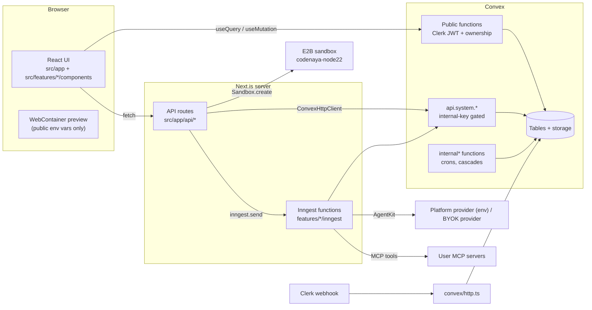

# Engineering standards

How code in this repo is structured, and what a reviewer will hold a PR to. Every rule
here comes from a pattern that already works somewhere in the codebase, or from a
problem that has already cost us a bug. When this document and the code disagree,
treat the code as debt to fix; don't copy the old pattern.

Decisions with real tradeoffs are recorded as ADRs in [`docs/adr/`](adr/). For Convex
APIs, [`convex/_generated/ai/guidelines.md`](../convex/_generated/ai/guidelines.md) is
the reference and takes precedence over memory or training data.

## 1. Architecture



There are three trust boundaries, and every piece of code sits on exactly one of them:

1. **Browser → Convex public functions.** The caller is the Clerk user in the Convex
   JWT (`ctx.auth`). Each function verifies identity and ownership itself.
2. **Browser → Next API route → `api.system.*`.** The route authenticates with Clerk.
   `api.system.*` trusts the `CODENAYA_CONVEX_INTERNAL_KEY` and *whatever ids it is
   given*, so the route has to check ownership before calling it
   ([ADR 0001](adr/0001-convex-backend-and-ownership-checks.md)).
3. **Inngest event → function.** Anything holding the event key can send an event, so
   the function re-validates what matters (model choice, key ownership) and doesn't
   take the event at its word ([ADR 0002](adr/0002-agent-runtime-inngest-agentkit-openrouter.md)).

## 2. Module boundaries

```
src/app/            routes, layouts, API route handlers. Thin: parse, auth, delegate.
src/features/<f>/   one product area. Owns its UI, hooks, server helpers, agent code.
src/components/ui/  shadcn primitives (generated; edit only to fix the primitive).
src/components/     app-wide composites (navbar, providers, legal page, landing).
src/lib/            feature-agnostic infrastructure (Convex client, Sentry, rate limits).
convex/             one file per domain (projects.ts, files.ts, skills.ts, ...).
e2e/                Playwright specs and fixtures.
```

Dependencies point **down**: `app → features → components, lib`. `lib` and
`components/ui` never import from `features`.

- **`projects` is the IDE shell.** `features/projects/components/project-id-view.tsx`
  composes the editor, chat, preview and skills panels, so it may import other
  features' top-level components. Other features shouldn't reach sideways for UI. If two
  features need the same component, move it to `src/components/`.
- **Don't import another feature's internals:** its `store/`, `inngest/lib/`, private
  `utils/`. Platform model construction used to live in the conversations agent's
  private `inngest/lib/` while `ai-providers` depended on it; it now lives in
  `features/ai-providers/server/platform-model.ts`, next to the BYOK builders.
- **Shared infrastructure goes in `src/lib/`.** For example, `src/lib/rate-limit.ts` is
  the app's only rate limiter, used by routes across several features.
- **No import cycles between features.**
- **Convex may import pure modules from `src/features`**, such as
  `convex/skills.ts:11-23` importing `features/skills/{limits,types,builtin}`. Those
  modules must stay pure TypeScript: no `react`, `next`, `@/lib/convex-client`, or Node
  built-ins. That way the same constant validates on the client and is enforced on the
  server.

### Feature folder layout

Use only the folders you need:

```
src/features/<feature>/
  components/     React components (kebab-case files, PascalCase exports)
  hooks/          use-*.ts: Convex useQuery/useMutation wrappers, UI hooks
  server/         server-only helpers called by API routes / Inngest (never "use client")
  inngest/        Inngest functions; inngest/tools/ one AgentKit tool per file
  store/          zustand stores (use-*-store.ts), UI state only
  utils/          pure helpers, unit-tested next to the file
  <name>.ts       pure, shareable modules: types, limits, constants, registries
```

`features/skills/` is the model to follow. Pure rules (`limits.ts`, `parse-slash.ts`)
sit at the top level with tests, `server/` handles import and resolution, and
`components/` only renders.

## 3. Convex

Read `convex/_generated/ai/guidelines.md` before writing Convex code. Repo-specific
rules:

- **Domain files.** Functions go in the file for their table (`convex/projects.ts`,
  `convex/skills.ts`). `convex/system.ts` (1,800 lines) holds every internal-key
  function for every domain. Don't grow it. The first PR that needs a new internal-key
  function moves `validateInternalKey` (`system.ts:19`) into a shared
  `convex/internalKey.ts` and puts the new function in its domain file.
- **Validators on every function**, args and returns. Reuse the validators exported from
  `convex/schema.ts` (`messageStepValidator`, `aiProviderValidator`,
  `runModelValidator`) instead of redeclaring their shape.
- **Public, internal-key, or internal.**
  - Public (`query`/`mutation`): called from the browser. It must call `verifyAuth`
    (`convex/auth.ts`) and check ownership.
  - Internal-key (`api.system.*`): called from Next/Inngest through `convex` in
    `src/lib/convex-client.ts`, with `validateInternalKey(args.internalKey)` as its
    first line.
  - `internalMutation`/`internalQuery`/`internalAction`: crons, scheduled batches and
    cascades nobody calls directly. `convex/maintenance.ts` has the rationale.
- **One ownership helper per resource.** Use `getOwnedProject(ctx, id, ownerId)` from
  `convex/projects.ts:30`. It also treats `deletingAt` projects as gone. Import the
  shared helper; don't write another copy.
- **Ids from outside are strings.** When an id comes from model output or a URL, take
  `v.string()` and `ctx.db.normalizeId(...)`, then return `null` for a malformed id, as
  `getOwnedProject` does at `convex/system.ts:1537`. Otherwise Convex throws an
  `ArgumentValidationError`, and callers end up matching on its message
  (`features/conversations/inngest/tools/get-file.ts:26`).
- **Typed errors.** New code throws `ConvexError({ code, message })` with
  `code ∈ NOT_FOUND | FORBIDDEN | UNAUTHENTICATED | INVALID_ARGUMENT | CONFLICT |
  LIMIT_EXCEEDED`. Clients branch on `error.data.code`, never on message text. Convex
  replaces plain `Error` messages with "Server Error" in production, so a message is
  not an API. The ~110 existing `throw new Error` sites are debt; convert them when you
  touch them.
- **Every read is bounded.** Use `.withIndex(...)` (never `.filter()` on a query) plus
  `.take(MAX_*)`, `.first()`, `.unique()` or `.paginate()`. Name limits as constants
  next to their use (`MAX_KEYS_LISTED`, `MAX_PROJECT_SETTINGS`, `BATCH_SIZE`). Allow
  `.collect()` only when the index range has a hard bound you can name in a comment.
  To keep the last N rows, read `.order("desc").take(n)` and reverse in memory, as
  `api.system.getRecentMessages` does. Clamp any client-supplied limit.
- **Large deletes and backfills run in batches** that reschedule themselves
  (`convex/projectCascade.ts`, `projects.deleteBatch`, `maintenance.ts`
  `BATCH_SIZE = 200`).
- **Indexes** are named `by_<field>[_<field>]` and include every field they filter on
  (`by_project_status`). Add an index rather than filtering in memory.
- **Schema changes** need a migration plan in the PR body when they change existing
  rows. Make new fields `v.optional` first, then backfill.

## 4. API routes (`src/app/api/**/route.ts`)

A route handler parses, authenticates, authorizes and delegates. Business logic goes in
`features/<f>/server/` or Convex. Every route runs these steps in this order:

```ts
const { userId, unauthorized } = await requireUserId();          // 401
if (unauthorized) return unauthorized;

const rateLimit = checkRateLimit(userId, FOO_RATE_LIMIT);         // 429
if (!rateLimit.allowed) return rateLimitedResponse(rateLimit);

const { data, invalid } = await parseJsonBody(request, requestSchema); // 400
if (invalid) return invalid;

const { found: project, notFound } = await requireOwnedProject({  // 404
  internalKey, userId, projectId: data.projectId,
});
if (notFound) return notFound;
```

- `requireUserId` lives in `features/auth/server/require-user-id.ts`.
  `requireOwnedProject` and `requireOwnedConversation` live in
  `features/projects/server/require-owned-project.ts`. Missing, malformed and foreign
  ids all return the same 404, so a caller can't probe which projects exist (#208).
- **Parse the body with `parseJsonBody`** (`lib/parse-json-body.ts`). Malformed JSON and
  schema failures both answer 400; a bare `request.json()` or `requestSchema.parse(body)`
  turns bad input into a 500 (#235).
- **Rate-limit every route that calls an LLM, an external network, or writes per
  request.** Add a named `RateLimitConfig` next to the existing ones. The limiter is
  per-instance by design (header of `rate-limit.ts`).
- **Error bodies are `{ error: string, code?: string }`.** `code` is a stable snake_case
  value the client can branch on (`credential_detected`, `dispatch_failed`).
- Read `CODENAYA_CONVEX_INTERNAL_KEY` and other secrets per request, never at module
  load, so `next build` works without them (`ai-providers/server/platform-model.ts` explains why).

## 5. Agent and Inngest

- **One function per file** in `features/<f>/inngest/`, registered in
  `src/app/api/inngest/route.ts`. Events are `noun/verb` (`message/sent`,
  `message/cancel`).
- **Deterministic code goes in `step.run`.** That covers every Convex write and every
  external call whose result must not repeat on replay. Step ids are unique kebab-case
  verbs (`create-checkpoint`).
- **Secrets never become step output.** Inngest persists every `step.run` return value.
  Decrypted BYOK keys, OAuth tokens and MCP clients get resolved in the function body,
  outside any step, and held in memory. See `resolveRunModel` and the comments at
  `process-message.ts:153-158` and `:309-320`. A step that needs a secret reads it
  *inside* its body and returns only non-secret data.
- **Throw `NonRetriableError` for permanent failures** (missing config, missing row) so
  Inngest doesn't retry them. A user-facing failure updates the message and returns; it
  doesn't throw.
- **Tools** (`inngest/tools/<name>.ts`) export `create<Name>Tool(options)` and are
  scoped by closure to the run's `projectId`. Validate params with zod `safeParse`, and
  return `Error: ...` strings for the agent's own mistakes (bad id, folder-not-file) so
  it can correct itself. Throw only for transient failures. Wrap the mutation in
  `toolStep?.run(...)`. `tools/update-file.ts` is the template.
- **LLM access goes through the platform provider**
  (`features/ai-providers/server/platform-model.ts`, chosen by `NEXT_PUBLIC_AI_PROVIDER`,
  ADR 0005) or the user's BYOK key (`features/ai-providers`). No new provider SDK clients.
- **Prompt text and model-visible strings** go in `constants.ts` next to the function.

## 6. UI

- **Use the primitives.** Build from `src/components/ui` (shadcn, new-york, lucide
  icons). Add primitives with `npx shadcn add`. Don't hand-roll a dialog, popover or
  menu that Radix already provides. Toasts use `sonner` (`toast.error`).
- **Colors come from tokens only.** Use `bg-background`, `text-muted-foreground`,
  `border-border`, `bg-sidebar` and the other variables in `src/app/globals.css`. Raw
  palette classes (`bg-zinc-900`) and hex values are allowed only in code we hand to
  generated apps (`features/templates/seed-files.ts`) and in the CodeMirror theme
  (`features/editor/extensions/theme.ts`).
- **Dark and light both work.** `next-themes` (`src/components/theme-provider.tsx`)
  toggles `.dark`. Check every UI change in both themes and at 375px wide
  (`e2e/dashboard-responsive.spec.ts` shows how).
- **Accessibility.** Icon-only buttons get `aria-label` or `sr-only` text. Interactive
  elements are real `<button>`/`<a>` elements and reachable by keyboard. Dialogs keep
  Radix focus management. Anything an e2e spec selects should be selectable by role and
  name (`getByRole("button", { name: ... })`), which keeps tests and screen readers
  honest together.
- **State.** Server state is Convex (`useQuery`, wrapped in `features/<f>/hooks/use-*.ts`,
  with optimistic updates as in `projects/hooks/use-projects.ts`). Client-only UI
  state that crosses components goes in a zustand store (`editor/store/use-editor-store.ts`).
  Don't copy Convex data into a store.
- **Client vs server.** Put `"use client"` on the smallest leaf that needs it. Server
  helpers (`features/*/server/`) never get imported from a client component.

## 7. Errors, logging, Sentry

- Fail fast at the boundary, and give each layer one way to report failure: Convex
  throws `ConvexError`, routes return `{ error, code }` with a status, tools return
  `Error: ...`, and Inngest throws (retryable) or `NonRetriableError`.
- A user-facing message names the fix. For example, the BYOK failure points to
  `/settings/ai-providers`, and `readPlatformApiKey` names the variable to set.
- Don't swallow errors. A `catch` either handles a specific, named case or rethrows.
  `catch {}` is allowed only around best-effort cleanup, with a comment saying so.
- Sentry is already wired in: `sentry.*.config.ts`, `@inngest/middleware-sentry` in
  `src/inngest/client.ts`, and `app/global-error.tsx`. Unhandled errors reach it on
  their own, so don't wrap code just to call `captureException`.
- `console.warn` and `console.error` get a `[module]` prefix
  (`[message-processor] ...`). Never log secrets, tokens, env values, user code or
  prompt contents. The e2e suite fails on new browser console errors
  (`e2e/console-errors.ts`).

## 8. Testing

| Layer | Tool | Lives | Write one when |
| --- | --- | --- | --- |
| Unit | Vitest (node) | `*.test.ts` next to the file | Any pure function: parsing, limits, registries, crypto, prompt builders |
| Convex | `convex-test` (`// @vitest-environment edge-runtime`) | `convex/<domain>.test.ts` | Every new or changed Convex function, **including the negative authz case** (Bob can't read Alice's project, as in `convex/system.ownership.test.ts`) |
| Route | Vitest with mocked Clerk/Convex | `src/app/api/**/route.test.ts` | Routes with branching validation or rate limits (`api/enhance-prompt/route.test.ts`) |
| e2e | Playwright | `e2e/<flow>.spec.ts` | One smoke spec per user flow; extend it when you fix a bug in that flow |

- Fix a bug by writing the failing test first.
- **e2e specs sign in through the Clerk pool** (`signIn(page)` from `e2e/clerk-auth.ts`,
  [ADR 0004](adr/0004-e2e-clerk-user-pool.md)). Specs that need secrets call
  `test.skip(!process.env.X, "reason")`. Specs use the `E2E_PROJECT_ID` fixture
  project and must not depend on order or on other users' data.
- Stub the LLM in e2e (`e2e/stub-provider.ts`, `e2e/chat-fixtures.ts`) unless the spec
  specifically tests the real provider path.
- Gates before merge: `npx tsc --noEmit`, `npm run lint` with 0 errors, `npm test`,
  `npm run build`, and the affected e2e specs.

## 9. Naming and size

- **Files and folders** are `kebab-case.ts(x)`. Components are `PascalCase`, hooks
  `useCamelCase` in `use-*.ts`, constants `SCREAMING_SNAKE`, and Convex functions
  `camelCase` verbs (`getOwnedProject`, `updateMessageStatus`).
- **Booleans** read as predicates (`isOutOfCredit`, `planMode`). Functions that return
  `T | null` are called `*OrNull`, or say "null when ..." in their doc comment.
- **Comments explain *why*,** not what, the way `rate-limit.ts` and `resolve-run-model.ts`
  do. Link the issue number when a line exists because of a bug (`(#209)`).
- **Size.** Split a file that passes ~300 lines or takes on a second responsibility.
  Don't grow these files further; extract from them as you work in them:
  `convex/system.ts` (1,797), `features/conversations/inngest/process-message.ts`
  (754), `app/api/sandbox/route.ts` (701), and
  `integrations/components/connection-scope-form.tsx` (662).
- **Functions** stay under ~60 lines, and pure logic gets pulled out of components and
  handlers so it can be unit-tested.

## 10. Dependencies

- A new dependency needs a sentence in the PR body: what it replaces, why existing code
  or a current dependency can't do the job, its size, and its maintenance status. Prefer
  what's already installed: zod, date-fns, ky, nanoid, motion, sonner, zustand.
- npm only (`package-lock.json`). Don't commit `bun.lock` or `pnpm-lock.yaml`.
- Security pins go in `overrides` in `package.json`, with a version range.
- `@playwright/test` stays pinned to the version whose Chromium is cached on the server
  (`playwright.config.ts`).

## 11. Pull requests

- **One concern per PR.** Keep it under ~400 changed lines, not counting tests and
  generated files. Split it otherwise. Branch from `main` as `fix/issue-<n>-<slug>`,
  `feat/<slug>` or `docs/<slug>`.
- **Titles and commits** use Conventional Commits with an optional issue scope:
  `fix(#221): reference-check blob deletes ...`, `feat(chat): ...`, `test(e2e): ...`.
  Write the summary in the imperative mood, lower case, with no trailing period.
- **The body covers** context (what's broken, with evidence), the approach and any
  alternatives rejected, what's out of scope, verification (gates plus e2e plus
  screenshots for UI), and `Closes #<n>`.
- **No AI attribution** anywhere: no `Co-Authored-By` trailers, no "Generated with"
  footers. Commits use the repo's configured git identity.
- **Merge commits only.** Never squash or rebase-merge, and never force-push. Bring a
  branch up to date with `git merge origin/main`.
- Delete the code you replace in the same PR. Don't leave dead paths behind flags.

## 12. Design notes and ADRs

- **Design note.** Write one before coding any change that is medium or larger (new
  table or field, new route, new agent tool, a change touching more than one feature, or
  anything over ~200 lines). Keep it to half a page: the problem, the approach, the
  alternatives considered, data model and API changes, where the code lives and why,
  and the test plan. Get it agreed before you start. It then goes in the PR body.
- **ADR.** Write one for decisions that are expensive to reverse: a new module or
  pattern, a new dependency or external service, a schema shape, or a change that cuts
  across features. Copy [`adr/0000-template.md`](adr/0000-template.md) to
  `adr/NNNN-kebab-title.md` with the next number and land it in the same PR as the
  change. ADRs are immutable once accepted. To change a decision, write a new ADR that
  marks the old one `Superseded by NNNN`.

| ADR | Decision |
| --- | --- |
| [0001](adr/0001-convex-backend-and-ownership-checks.md) | Convex as the backend; ownership checked at every trust boundary |
| [0002](adr/0002-agent-runtime-inngest-agentkit-openrouter.md) | Agent runs on Inngest AgentKit via OpenRouter; BYOK keys resolved outside steps |
| [0003](adr/0003-e2b-node22-preview-template.md) | Cloud previews boot from a custom E2B Node 22 template |
| [0004](adr/0004-e2e-clerk-user-pool.md) | e2e tests sign in from a pool of Clerk test users |
| [0005](adr/0005-platform-ai-provider-by-env.md) | Platform AI provider chosen by env; Workflow backend retired |
| [0006](adr/0006-platform-provider-and-models-in-admin.md) | Platform provider and models set at runtime in /admin; env is the fallback |
| [0007](adr/0007-platform-ai-usage-ledger-and-plan-caps.md) | Platform AI usage metered per user per month; per-plan USD/token caps enforced server-side |
